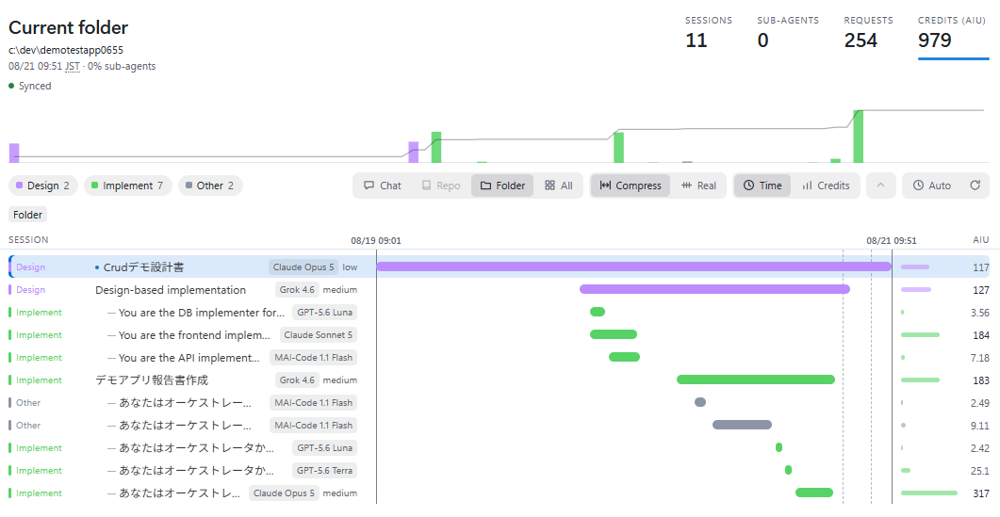

# Credit Timeline

[English](README.md) | 日本語

Copilot のセッションとサブエージェントを時系列のタイムラインに並べ、クレジット (AIU) の
消費先をひと目で把握するための GitHub Copilot canvas extension です。

データはローカルの Copilot セッションストアから読み取るだけで、外部には送信しません。



## 特長

- **タイムライン** — 1 行 1 セッション。推定したステージで色分けし、サブエージェントの
  起動時刻を目盛りで表示します。
- **クレジット概要** — 時間バケットごとの AIU を積み上げ、累積比率を折れ線で重ねます。
- **セッション階層** — 子セッションや fork を親の下に字下げ表示。行ごとの `Focus` と
  パンくずで絞り込みできます。
- **スコープ** — 現在のチャットツリー / リポジトリ / フォルダー / 全セッション。
- **長期間でも読める** — 40 分以上の無活動区間は破線に畳んで密度を保ちます。
- **ライブ更新** — 自動更新、agent からの更新、Server-Sent Events による同期。

## 動作要件

- canvas extension に対応した GitHub Copilot app（canvas API は実験的機能です）
- `$COPILOT_HOME`（既定: `~/.copilot`）配下のローカルセッションデータ
- `node:sqlite` が使える Node.js ランタイム

## インストール

`credit-timeline/` ディレクトリを extension の探索先へコピーします。

```bash
# ユーザースコープ（全プロジェクト）
cp -r credit-timeline "$COPILOT_HOME/extensions/credit-timeline"

# もしくはプロジェクトスコープ
cp -r credit-timeline .github/extensions/credit-timeline
```

コピー後、GitHub Copilot app で extension を再読み込みしてください。

## 使い方

Copilot にキャンバスを開くよう依頼するか、直接呼び出します。

```text
open_canvas({ canvasId: "credit-timeline", instanceId: "credit-timeline-1" })
```

open input には `scope`（`current_chat_tree` / `current_repository` /
`current_folder` / `all_sessions`）と `repository` / `folder` を指定できます。
`refresh`・`top_consumers` の各 action も同じ項目を受け付けます。

```text
open_canvas({ canvasId: "credit-timeline", instanceId: "credit-timeline-1",
              input: { scope: "current_repository", repository: "owner/repo" } })
```

## AIU について

AIU = ローカルセッションストアの `SUM(total_nano_aiu) / 1,000,000,000` で、記録された
モデル使用量です。premium request 枠や課金額ではありません。セッション行の AIU は
サブエージェント分を含む内数です。チャットウィンドウの「AI Credit」と異なり、本キャンバスは
コンテキスト圧縮も合計に含め、`compaction` として内数表示します。

## ドキュメント

画面の見方・各操作・ステージ分類ルール・参照データの詳細は
[credit-timeline/README.md](credit-timeline/README.md) を参照してください。

## 開発

```bash
node --test credit-timeline/data.test.mjs
```

## ライセンス

[MIT](LICENSE)
